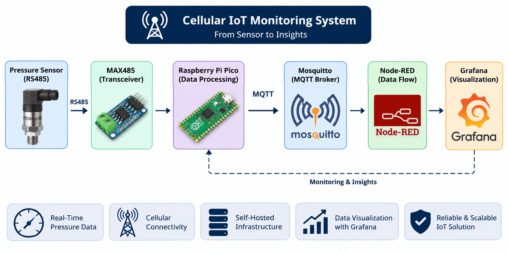

# Cellular IoT Monitoring System

An end-to-end Cellular IoT Monitoring System built around a Raspberry Pi Pico, EG800K cellular modem, sensors, and a PCF Real-Time Clock (RTC) module.

The system enables remote data acquisition and transmission using MQTT, with Mosquitto and Node-RED for messaging, data processing, and visualization. The supporting server infrastructure is self-hosted and managed through Proxmox.

---

## Features

- Cellular connectivity using the EG800K modem.
- Sensor data acquisition using Raspberry Pi Pico.
- Real-Time Clock integration using a PCF8563 module.
- MQTT communication using Mosquitto.
- Data processing with Node-RED.
- Data vizualisation using Grafana
- Self-hosted server infrastructure.

## Hardware Components

| Component | Description |
|---|---|
| Raspberry Pi Pico | Main microcontroller |
| EG800K | Cellular communication module |
| Sensors | Environmental data acquisition |
| PCF RTC Module | Real-time clock |

## Software & Technologies

- **Embedded:** Raspberry Pi Pico
- **Communication:** Cellular / MQTT
- **Messaging:** Mosquitto
- **Automation & Visualization:** Node-RED / Grafana
- **Infrastructure:** Docker
- **Server:** Self-hosted services

## System Architecture

<!-- Add your architecture diagram here -->

## Getting Started

Detailed installation and configuration instructions will be added here.

## Future Improvements

- Remote device monitoring.
- Asynchronous message handler for EG800 modem.
- Improved error handling and connectivity recovery.
- Additional sensor integration.

## Author

Developed as a personal Embedded Systems and IoT project.

## Third-Party Libraries

### Ring Buffer

This project uses a Single-Producer Single-Consumer (SPSC) Ring Buffer implementation originally developed by **Jan Oleksiewicz**.

- **Author:** Jan Oleksiewicz
- **License:** MIT
- **Version:** 2.0.5
- **Original source:** https://github.com/jnk0le/Ring-Buffer

The original copyright notice and license information have been preserved in the source file.